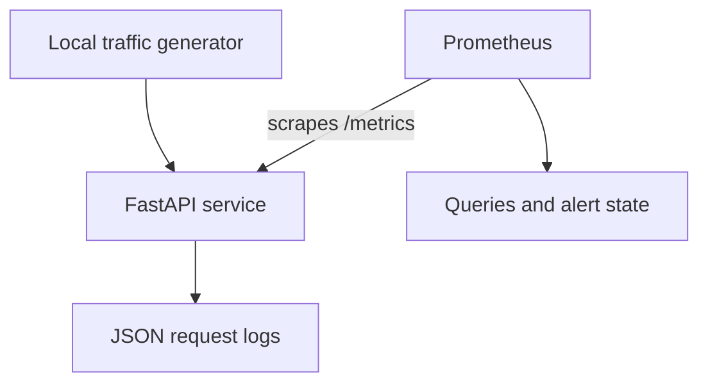

# Service Observability & Prometheus Monitoring

A personal support-engineering project for answering three operational questions: is the service reachable, is it failing requests, and is it getting slow?



## Implemented behaviour

- `/health`: service liveness. This does not check external dependencies.
- `/work`: controlled workload; optional bounded delay or HTTP 503 for experiments.
- `/items/{item_id}`: demonstrates grouping dynamic paths under one route label.
- `/metrics`: Prometheus counter and classic duration histogram.
- `X-Request-ID`: safe supplied IDs are retained; otherwise generated. Logs contain the ID, route, method, status and duration, without query strings or bodies.
- Three local alert rules: unavailable scrape target, elevated 5xx ratio, and elevated workload p95 latency.

Request IDs belong in logs, **not metric labels**. Routes use templates, and unknown paths use `unmatched`, so arbitrary IDs and URLs do not create unbounded series. Scrapes are excluded from application request metrics.

## Run the complete local stack

Requires Python 3.12 and Docker with Compose. Run from the repository root:

```bash
docker compose -p observability-lab -f observability/compose.yml up --build -d
curl http://127.0.0.1:8001/health
curl http://127.0.0.1:8001/metrics
```

Open Prometheus at **http://127.0.0.1:9090**. Inspect Targets and Alerts. Services are bound to loopback; do not add public inbound rules for ports 8001 or 9090.

Compose enables fault injection for the local exercise. The application defaults to faults **disabled** when run without that environment flag. Do not expose the fault-enabled app to public traffic.

## Generate evidence

```bash
python3 scripts/generate_traffic.py normal --seconds 30
python3 scripts/generate_traffic.py slow --seconds 150
python3 scripts/generate_traffic.py recovery --seconds 150
python3 scripts/generate_traffic.py errors --seconds 150
python3 scripts/generate_traffic.py recovery --seconds 150
docker compose -p observability-lab -f observability/compose.yml logs --tail 20 app
```

Traffic is sequential and fixed to the local service. The 150-second phases allow the one-minute metric window and one-minute alert hold to settle; allow an additional scrape/evaluation interval. These are demonstrations, not load or capacity benchmarks.

Capture the actual query result, alert state, timestamp and recovery action. A controlled HTTP 503 still allows successful metric scrapes: `up` can remain 1 while requests fail.

## Useful PromQL

Completed request count:

```promql
sum by (route, status) (lab_http_requests_total{job="observability-lab"})
```

5xx request ratio over the last minute:

```promql
sum(rate(lab_http_requests_total{job="observability-lab",status=~"5.."}[1m]))
/
sum(rate(lab_http_requests_total{job="observability-lab"}[1m]))
```

Estimated workload p95 in seconds:

```promql
histogram_quantile(0.95,
  sum by (le) (rate(lab_http_request_duration_seconds_bucket{job="observability-lab",route="/work"}[1m]))
)
```

Successful scrape:

```promql
up{job="observability-lab"}
```

No requests can produce an empty/NaN error ratio or percentile. Treat this as **no traffic**, not evidence of perfect health. Histogram quantiles are bucket-based estimates; these buckets include 300ms and 500ms to support the lab latency experiment.

## Run without Docker

```bash
python3 -m venv .venv
source .venv/bin/activate
pip install -r requirements-dev.txt
LAB_FAULTS_ENABLED=true uvicorn observability.main:app --port 8001 --log-config observability/logging.json
```

This runs the instrumented app only, not Prometheus. In another terminal use the traffic script or `curl`. Start a native Prometheus separately with its scrape target changed from `app:8000` to `127.0.0.1:8001` if desired.

## Validation

```bash
python -m pytest -q
docker run --rm --entrypoint /bin/promtool -v "$PWD/observability:/etc/prometheus:ro" -w /etc/prometheus prom/prometheus:v3.5.0 check rules alerts.yml
docker run --rm --entrypoint /bin/promtool -v "$PWD/observability:/etc/prometheus:ro" -w /etc/prometheus prom/prometheus:v3.5.0 test rules rules.test.yml
```

Tests cover metric counts for success/failure, delay observations, bounded labels, safe request IDs, fault opt-in, scrape exclusion, registry isolation and unexpected exceptions. Rule fixtures cover alert hold periods, target recovery, error ratio, high latency and absent traffic.

## Scope and trade-offs

- One app worker: in-memory metrics reset when the process restarts. Multiple workers require a different metric collection design.
- Classic histograms are used for the Python client and simple reproducibility. Quantiles are estimates, not exact request timings.
- Prometheus stores data in a named volume. There is no redundant monitoring service, persistent cloud storage, TLS or authentication.
- Alerts are visible in Prometheus. No Alertmanager, email or external notification delivery is configured.
- Thresholds are lab demonstration thresholds, not a business SLO. No error budget is defined or monitored.
- The middleware measures JSON response processing, not full streaming response delivery. This lab has no streaming endpoints.
- Image tags are pinned for reproducibility, not claimed to be latest. Review dependencies and image advisories before any deployment beyond the lab.

## Stop

```bash
docker compose -p observability-lab -f observability/compose.yml down
```

Add `-v` only when you intend to discard the lab's stored Prometheus samples.

## Design references

- [Prometheus instrumentation guidance](https://prometheus.io/docs/practices/instrumentation/)
- [Prometheus histograms](https://prometheus.io/docs/practices/histograms/)
- [Python client histogram](https://prometheus.github.io/client_python/instrumenting/histogram/)
- [FastAPI testing](https://fastapi.tiangolo.com/tutorial/testing/)
